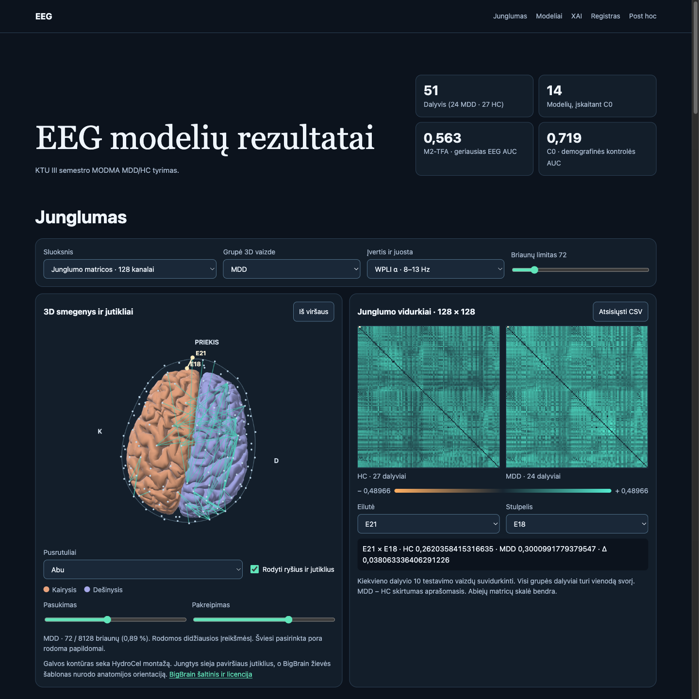

# EEG atlasas · III semestro tyrimas

[Atverti interaktyvų EEG atlasą](https://airidas23.github.io/eeg-atlasas/)



## Mokslinis dizainas

- **Klausimas.** Kiek 128 kanalų EEG funkcinio junglumo rodikliai padeda atskirti MODMA depresijos grupę (MDD) nuo sveikų kontrolinių dalyvių (HC)?
- **Imtis ir įvestis.** 51 dalyvis (24 MDD, 27 HC). Kiekvieną įvestį sudarė septynios 128 × 128 matricos: WPLI teta, alfa ir beta bei oAEC delta, teta, alfa ir beta juostose.
- **Vertinimas.** Palyginta 13 EEG modelių ir demografinė kontrolė C0. Taikytas penkiskart kartotas penkių dalių kryžminis patikrinimas dalyvių lygmeniu. To paties dalyvio įvestys vienoje išorinėje dalyje laikytos kartu. Pirminė metrika – penkių OOF AUC vidurkis su 95 % dalyvių bootstrap intervalu.
- **Rezultatas.** Geriausias EEG modelis M2-TFA pasiekė AUC **0,563**. Jo intervalas apima 0,5. C0 pasiekė AUC **0,719**. IG ir okliuzijos stabilumo kriterijų praėjo **0 iš 51** dalyvio visuose trijuose vertintuose modeliuose.
- **Interpretacija.** Tai metodinis MDD/HC tyrimas. Gydymo atsako prognozė ir klinikinis tinkamumas nebuvo vertinti. Atlaso jungtys rodomos HydroCel jutiklių erdvėje. BigBrain žievės modelis suteikia anatominį orientyrą.

## Peržiūra ir dalijimasis

Išskleiskite ZIP ir naršyklėje atverkite `index.html`. Interneto ryšio nereikia. 3D žievei reikia WebGL. Atlasas, suvestinės ir diagramos veikia iš vieno paketo.

Paketą perduokite tik gavėjo prašymu ir savo sprendimu. Jame yra kohortos agreguotų rezultatų. Individualūs EEG įrašai, tiriamųjų identifikatoriai ir individualūs XAI lieka vietiniame tyrimo kataloge.

## Atkūrimas tyrimo aplinkoje

Iš v0.3.0 projekto šaknies eksportuokite į naują katalogą:

```sh
.venv-mac/bin/python showcase/build.py --study runs/real_auto_20261102/study/study.json --out reports/atlas_export/eeg-atlasas
```

Anatomijos šaltiniai ir licencija pateikti [ANATOMY-LICENSE.txt](ANATOMY-LICENSE.txt).
